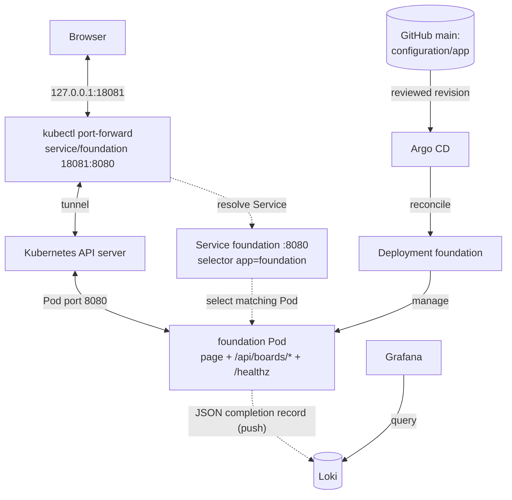

# Basic GitOps using Argo CD and Minikube

[](https://github.com/islandawolfe-02/Basic-GitOps-using-Argo-CD-and-Minikube/actions/workflows/p1-gates.yml)

Project 1 (BP Software Engineering Academy, Week 1): a reproducible GitOps deployment of the supplied treasure-hunt
**foundation**, a single ASP.NET Core image that serves a browser page and a board API on the same origin. The
deployment runs on a local minikube cluster. Argo CD reconciles a reviewed Git revision of `configuration/app`, and
request records go to Loki and Grafana. The project also includes one deliberate configuration failure, with its
diagnosis and recovery.

> **Scope.** Executed on a personal minikube cluster (MacBook Air M2) on 2026-11-14 and 2026-11-15, as the
> facilitator-approved replacement for the classroom Kubernetes/Argo CD environment. This is **not** a BP Yalla scaffold, BP pull request or BP deployment:
> those remain **pending** because the approved walkthrough was not supplied.

Status key: *executed on minikube (date)* / *historical (lab, date)* / *pending* / *unavailable on BP*.

The local Docker run, initial deployment, selector failure, recovery and blue → green change have saved evidence.
Fresh-clone build and local smoke checks passed on 2026-11-15. The handover PR and individual demonstration remain
**pending**. Full cluster setup was not repeated during the reproduction test. See [evidence-log.md](evidence-log.md)
for the milestone records.

## Architecture



The page calls the **relative** path `/api/boards/reference`, so the API request uses the same origin and tunnel as
the page. No cluster-internal hostname or CORS is involved. The port-forward carries traffic from the Mac through
the Kubernetes API server to a Pod selected using the Service. The Service is used to find the Pod; it is not an
extra hop in this tunnel. This is local port-forward access, not an Ingress.

| Route | Expected |
|---|---|
| `GET /` | foundation page "Treasure hunt board preview" |
| `GET /api/boards/reference` | `200`, 3 × 3 board, 6 initial moves, headers `X-Lab-Release: foundation-observe-a`, `X-Lab-Environment`, echoed `X-Request-Id` |
| `GET /api/boards/missing` | `404 {"code":"NOT_FOUND","message":"Board not found"}` |
| `GET /healthz` | `200 Healthy` (narrow liveness only) |

## Repository layout

| Path | Owner | Purpose |
|---|---|---|
| `app/` | supplied (unchanged except `wwwroot/client.json`) | foundation source, release `foundation-observe-a` |
| `app/wwwroot/client.json` | owned | browser deadline/retries |
| `runtime.env` | owned | public `LAB_ENV` for the local container |
| `Containerfile` | owned | multi-stage, digest-pinned packaging recipe |
| `configuration/app/resources.yaml` | owned | desired state: ConfigMap, Deployment, Service (Argo CD source path) |
| `argocd/application.yaml` | environment | Argo CD Application template |
| `observability/` | environment | Loki 3.7.8 + Grafana 13.2.3 (W1.10 datasource and dashboard) |
| `scripts/` | environment | `p1.env` session variables, `smoke.sh`, `check-config.sh`, `setup-cluster.sh` |
| `.github/workflows/p1-gates.yml` | environment | CI gates (build + smoke, configuration); never deploys |
| `evidence/`, `evidence-log.md` | owned | real outputs per milestone |

## Starting files and source version

* Supplied application copied unchanged from the course `projects/code/app` (release `foundation-observe-a`).
  Initial repository import: [`e8244883e0235c9ee5d646b6d8e1d187ffc6105a`](https://github.com/islandawolfe-02/Basic-GitOps-using-Argo-CD-and-Minikube/commit/e8244883e0235c9ee5d646b6d8e1d187ffc6105a).
  Source revision recorded for the checked Mac image: `5153f37a19a7e9326f2532817100eecc00eb29b6`
  ([source-commit.txt](evidence/m2-local/source-commit.txt)). Later deployment revisions changed configuration and
  evidence; the application image stayed the same.
* Packaging change against the classroom guided recipe: the host `dotnet publish` + `COPY publish/` became a build stage
  inside `mcr.microsoft.com/dotnet/sdk:10.0.401` (pinned by digest). The runtime base is unchanged
  (`aspnet:10.0.12@sha256:222759b3…`), and so are the listener on 8080 and the entrypoint. Reason: the MacBook and CI need no local .NET SDK.

## Prerequisites

macOS on Apple silicon, Docker Desktop, minikube, kubectl, Argo CD CLI, Mike Farah's yq v4, Git and curl.
With Homebrew available, install the command-line tools with `brew install minikube kubectl argocd yq git`;
`gh` is optional for creating and reviewing GitHub PRs from the terminal. Open Docker Desktop before cluster setup.

Recorded versions ([tool-versions.txt](evidence/m6-reproduce/tool-versions.txt)):

| Tool | Version |
|---|---|
| Docker Engine / CLI | 29.6.2 |
| Docker Desktop | 4.83.0 (234302) |
| minikube | 1.39.0 |
| kubectl client | 1.37.1 |
| Argo CD CLI | 3.6.1 |
| yq | 4.54.2 |

Cluster components are pinned: Argo CD **3.5.2** (core install), Loki **3.7.8**, Grafana **13.2.3**.
The installed Argo CD CLI version is separate from the cluster installation version.
Session variables (public values, no credentials) are in [`scripts/p1.env`](scripts/p1.env): `P1_NAMESPACE`,
`P1_SESSION`, `P1_IMAGE`, `P1_LOCAL_LOKI_URL`, `P1_CLUSTER_LOKI_URL`, `P1_GRAFANA_URL`.

## Quick start (fresh clone)

These steps are for a fresh Docker/minikube environment using a clean clone of reviewed `main`. The current desired
environment is **workshop-green**, with configuration revision **3**. The fresh-clone build and local checks have
been verified; the complete fresh-cluster walkthrough has not been repeated. Recorded deployment results are below.

Run commands from the repository root in zsh. Run `source scripts/p1.env` in every new terminal.

```bash
git clone https://github.com/islandawolfe-02/Basic-GitOps-using-Argo-CD-and-Minikube.git
cd Basic-GitOps-using-Argo-CD-and-Minikube
source scripts/p1.env
set -o pipefail
bash scripts/setup-cluster.sh                       # minikube, Argo CD, Loki/Grafana, namespace, Application
export P1_REVISION=$(git rev-parse HEAD)             # reviewed source/configuration revision for this clone
```

Keep a Loki port-forward running in a separate terminal so the local Docker container can send logs:

```bash
kubectl -n observability port-forward svc/loki 3100:3100
```

Keep another terminal open for Grafana:

```bash
kubectl -n observability port-forward svc/grafana 3000:3000
```

Back in the main terminal, build and check the image. Use new evidence folders to preserve the milestone outputs:

```bash
# Build and check locally (packaging gate)
mkdir -p evidence/quickstart-local evidence/quickstart-cluster
bash scripts/check-config.sh
printf '%s\n' "$P1_REVISION" | tee evidence/quickstart-local/source-commit.txt
docker build -f Containerfile -t "$P1_IMAGE" . 2>&1 | tee evidence/quickstart-local/build.log
docker image inspect "$P1_IMAGE" --format '{{.Id}}' | tee evidence/quickstart-local/image-id.txt
docker run -d --name "$P1_NAMESPACE-local" -p 127.0.0.1:18080:8080 --env-file runtime.env \
  -e LAB_SESSION="$P1_SESSION" -e LOCAL_LOKI_URL="$P1_LOCAL_LOKI_URL" "$P1_IMAGE"
bash scripts/smoke.sh http://127.0.0.1:18080 "$(sed -n 's/^LAB_ENV=//p' runtime.env)" evidence/quickstart-local \
  | tee evidence/quickstart-local/smoke.txt
```

Proceed when the build and smoke checks pass. The expected smoke result is `RESULT: PASS`.

```bash
# Import the checked image into the cluster (the classroom facilitator's import), then deploy the reviewed revision
minikube image load "$P1_IMAGE"
minikube ssh -- docker image inspect "$P1_IMAGE" --format '{{.Id}}' \
  | tee evidence/quickstart-local/minikube-image-id.txt
# SSH can add a carriage return; ignore it during comparison, keeping the raw evidence.
diff evidence/quickstart-local/image-id.txt \
  <(tr -d '\r' < evidence/quickstart-local/minikube-image-id.txt) && echo "SAME IMAGE ID"
argocd --core app sync "$P1_NAMESPACE" --revision "$P1_REVISION"
argocd --core app wait "$P1_NAMESPACE" --sync --health --timeout 90
kubectl -n "$P1_NAMESPACE" get deployment,pods,service,endpointslices -o wide
kubectl -n "$P1_NAMESPACE" get pods -l app=foundation \
  -o jsonpath='{.items[0].status.containerStatuses[0].imageID}{"\n"}'
kubectl -n "$P1_NAMESPACE" port-forward service/foundation 18081:8080   # leave running
```

In another terminal, from the same clone:

```bash
source scripts/p1.env
set -o pipefail
bash scripts/smoke.sh http://127.0.0.1:18081 "$(sed -n 's/^LAB_ENV=//p' runtime.env)" evidence/quickstart-cluster \
  | tee evidence/quickstart-cluster/smoke.txt
```

Open `http://127.0.0.1:18081`, choose **Reference**, and click **Load board**. Save the browser observation and copy
`attempts[0].request_id`. Confirm its row in the **P1 Foundation requests** dashboard at
`http://127.0.0.1:3000/d/w110-requests`, or use Explore with Loki:

```logql
{job="academy-w110", session="p1-islandawolfe-02-mac"} | json | request_id="<new request ID>"
```

Choose a time range covering the request. The `academy-w110` job label is retained by the supplied application;
the session and request ID identify this project run. Save Pod logs and the matching Grafana screenshot separately.

A peer's rebuilt image may have a **different** image ID. Compare source/configuration, review the new image's
checks, and confirm that its Mac, minikube and Pod SHA values agree. The historical IDs below describe the recorded
run; they are not assumed IDs for a rebuild. A Pod image ID can include a `docker://` prefix.

## Fresh-clone reproduction status

**Executed locally with Docker on the personal Mac (2026-11-15); handover PR pending.** A separate clone of merged
`main` was built and run under a separate image label and container name on port 18082.

| Reproduction check | Recorded result |
|---|---|
| Fresh-clone source revision | `b835e85ad03dce1e595dd170db8f7a53e0102087` |
| Source/configuration comparison | PASS: application, Containerfile, runtime.env and Kubernetes configuration match the handover checkout |
| Configuration gate | RESULT: PASS; workshop-green |
| Image label | `localhost/p1-repro:foundation-a` |
| Rebuilt image ID | `sha256:a1d271bbbd7c4c2eb66d4683f72ea5f6d33fe9a111e6cbcfb4920d933d565eac` |
| Local container / URL | `p1-repro-local` / `http://127.0.0.1:18082` |
| Local smoke checks | RESULT: PASS; exact reference body, foundation-observe-a, workshop-green, echoed request ID and missing-board 404 |
| Reference request | `smoke-20261115T163723Z-72646`, local container log at `2026-11-15T16:37:23.6452694Z` |

Evidence: [source revision](evidence/m6-reproduce/source-commit.txt), [comparison](evidence/m6-reproduce/comparison.txt),
[configuration check](evidence/m6-reproduce/config-check.txt), [build](evidence/m6-reproduce/build.log),
[rebuilt image ID](evidence/m6-reproduce/image-id.txt), [smoke result](evidence/m6-reproduce/smoke.txt),
[response headers](evidence/m6-reproduce/local/reference-headers.txt) and [container log](evidence/m6-reproduce/container.log).

The rebuilt ID differs from the original Mac/minikube image ID listed below. The source/configuration comparison
and checks passed, but the images are not claimed to be byte-identical. This reproduction image was used for a
local test; it is separate from the recorded deployed image. This test did not recreate the cluster, redeploy
through Argo CD or repeat browser/Grafana verification. Those earlier results remain separately recorded.

## Build and image identity

| Item | Value |
|---|---|
| Image label | `localhost/p1-islandawolfe-02:foundation-a` |
| Local image ID (Mac, `docker image inspect`) | `sha256:e563cb59f857747b351e1a10664086a2a49b2645a1b0b3c45d06ae82d83b4947` |
| Runtime image ID in minikube (`minikube ssh -- docker image inspect`) | `sha256:e563cb59f857747b351e1a10664086a2a49b2645a1b0b3c45d06ae82d83b4947` |
| Pod `status.containerStatuses[0].imageID` | `docker://sha256:e563cb59f857747b351e1a10664086a2a49b2645a1b0b3c45d06ae82d83b4947` |
| CI image ID (amd64 gate build, **not deployed**) | see the [green configuration CI run](https://github.com/islandawolfe-02/Basic-GitOps-using-Argo-CD-and-Minikube/actions/runs/43730381115) summary |

Recorded ID sources: [Mac image](evidence/m2-local/image-id.txt), [minikube image](evidence/m2-local/minikube-image-id.txt),
[green Pod image](evidence/m5-green/pod-image-id.txt). The checked local image was built on 2026-11-13 and reused for
the deployments on 2026-11-14 and 2026-11-15.

## Public configuration

* `LAB_ENV`: `workshop-green` (`runtime.env` and the ConfigMap agree; `check-config.sh` enforces it).
  The earlier local run, initial deployment, selector failure and recovery used `workshop-blue`.
  Pod-template annotation `academy/config-revision` is `"3"`; the green change increased it from `"2"` in the same
  commit as the ConfigMap change. Environment variables are read at container startup, so the annotation triggers
  a replacement Pod to read the new settings. Keep the resource names, one replica, `DOTNET_PROCESSOR_COUNT`,
  `imagePullPolicy: Never` and `/healthz` probes. A later ConfigMap change needs another annotation increment.
* `client.json`: `{"deadlineMs":450,"retries":0}`. Justification (historical, W1.10, 2026-11-02): the slowest fixture the
  browser must receive (Slow) needed about 302 ms of server processing. A retry starts a new request that restarts that
  work, so retries cannot help. Only the per-attempt deadline matters. 400/0 received Slow in 315 ms, and 200/2 failed
  all three attempts. 450/0 keeps a margin above about 300 ms within the 650 ms budget, and Overdue (900 ms) stays a
  bounded *unavailable* outcome at about 450 ms.
* Service: selector `app: foundation` must match the Pod-template label. `port: 8080` → `targetPort: http`, which is
  the named container port 8080. `imagePullPolicy: Never` because the image is imported into the node with
  `minikube image load`. This is not a registry policy. The probes check `/healthz`, which shows the process answers,
  not that the board response is right.

## Deployment revision and review

| Step | Revision (full) | PR | Self-review decision | Argo sync / health |
|---|---|---|---|---|
| Initial deploy | `8ae88b2f112824f7aef4dc3d0ef51eeb941335b2` | [#3](https://github.com/islandawolfe-02/Basic-GitOps-using-Argo-CD-and-Minikube/pull/3) | Separate self-review comment missing | Synced / Healthy; 2026-11-14 13:49:33 UTC |
| Failure: selector `foundation-missing` | `758e954c73aeeb56656d48e00de32ea6d2150071` | [#5](https://github.com/islandawolfe-02/Basic-GitOps-using-Argo-CD-and-Minikube/pull/5) | [Approved for the controlled failure](https://github.com/islandawolfe-02/Basic-GitOps-using-Argo-CD-and-Minikube/pull/5#issuecomment-6880084812) | Synced / Healthy; Service unreachable; 2026-11-14 15:57:42 UTC |
| Recovery: selector restored | `35f31eb5c0aec482d4e44b6a47d370225555c7e5` | [#6](https://github.com/islandawolfe-02/Basic-GitOps-using-Argo-CD-and-Minikube/pull/6) | [Approved](https://github.com/islandawolfe-02/Basic-GitOps-using-Argo-CD-and-Minikube/pull/6#issuecomment-6880673349) | Synced / Healthy; 2026-11-14 16:33:27 UTC |
| Environment blue → green | `2eeb5e125cb690fd89662e93a81c5aa09fbfa65e` | [#9](https://github.com/islandawolfe-02/Basic-GitOps-using-Argo-CD-and-Minikube/pull/9) | [Approved](https://github.com/islandawolfe-02/Basic-GitOps-using-Argo-CD-and-Minikube/pull/9#issuecomment-6896913674) | Synced / Healthy; 2026-11-15 15:38:20 UTC |

Review happens on the GitHub pull request. CI (`p1-gates`) is a check, not the approver. A merged PR only publishes the
revision. The deployment happens when `argocd --core app sync --revision <full sha>` reconciles it.

The Configuration gate caught the deliberate selector fault in PR #5; its Package gate passed. The failed
configuration check was recorded and accepted for that bounded exercise. The recovery and green configuration
PRs passed CI. Argo reported Healthy even during the selector failure, so endpoint and request checks are required.

## Startup and verification

| Check | Command | Expected | Actual (time UTC, request ID) |
|---|---|---|---|
| Health | `curl http://127.0.0.1:18081/healthz` | 200 Healthy | PASS in green smoke; Pod log records 200 at 2026-11-15 15:41:35 UTC |
| Reference (browser) | open `http://127.0.0.1:18081`, Reference, Load board | 200, 3×3, 6 moves, `foundation-observe-a`, green | 200, workshop-green; request `1320ef47-3114-4cec-aa17-75a6c053910f`, matching Pod log at 2026-11-15 15:41:58.2315687 UTC |
| Reference (API) | `bash scripts/smoke.sh http://127.0.0.1:18081 workshop-green` | RESULT: PASS | PASS; exact reference body and expected headers; request `smoke-20261115T154135Z-37768`, 2026-11-15 15:41:35 UTC |
| Missing | `/api/boards/missing` | 404 NOT_FOUND | PASS in the saved green smoke result |
| Endpoint | `kubectl -n p1-islandawolfe-02 get endpointslices` | ready endpoint → the foundation Pod | `10.244.0.96` matches Pod `foundation-6554c98847-wfpmk`, Running/Ready, config revision 3 |
| Grafana | `{job="academy-w110", session="p1-islandawolfe-02-mac"} \| json \| request_id="1320ef47-3114-4cec-aa17-75a6c053910f"` | matching row | Screenshot shows the same request, 200, foundation-observe-a and workshop-green at 2026-11-15 15:41:58.2315687 UTC |

These are **executed on personal minikube (2026-11-15)** results, supported by
[smoke output](evidence/m5-green/smoke.txt), [reference headers](evidence/m5-green/reference-headers.txt),
[browser observation](evidence/m5-green/browser-observation.json), [Pod logs](evidence/m5-green/pod-logs.txt),
[resource state](evidence/m5-green/state.txt) and the [Grafana screenshot](evidence/m5-green/grafana.png).
The browser action took 62 ms; server processing for its matching request took 2 ms. Those measure different parts
of the request path.

## Controlled failure and recovery

* **Failure (2026-11-14):** the Service selector changed `app: foundation` → `app: foundation-missing`. The prediction
  recorded in PR #5 was that the Pod would remain healthy, the Service would have no ready endpoints, and a fresh
  port-forward would fail. Observed: Pod `foundation-7d5c485f7d-bdp6l` stayed `1/1 Running` with zero restarts,
  EndpointSlice endpoints were `<unset>`, and a fresh port-forward failed with `error: timed out waiting for the condition`.
  Evidence: [state](evidence/m5-failure/state.txt), [port-forward error](evidence/m5-failure/port-forward.txt).
  Rebuilding the image would not help: the image was never the fault. The Service's label query matched no Pod.
* **Recovery (2026-11-14):** corrective revision `35f31eb5c0aec482d4e44b6a47d370225555c7e5` restored `app: foundation`.
  The same Pod became reachable through a fresh port-forward; [smoke checks passed](evidence/m5-recovery/smoke.txt).
  Browser request `b9e887fa-e252-4692-92db-137da62f2485` matched the Pod logs and
  [Grafana row](evidence/m5-recovery/grafana.png) at `2026-11-14T16:42:13.3211060Z`, status 200, workshop-blue.
  The cumulative recovery logs contain an earlier 2-second Loki delivery timeout; this recovery request was delivered.
* **Environment change (2026-11-15):** ConfigMap and runtime-file `LAB_ENV` changed to `workshop-green`, and
  `academy/config-revision` increased `"2"` → `"3"` in commit `50d96b112bda981650366e0b56768c6737fc3d98` (PR #9).
  Argo synced its merged revision `2eeb5e125cb690fd89662e93a81c5aa09fbfa65e`. The new Pod
  `foundation-6554c98847-wfpmk` replaced the blue Pod and a fresh request returned
  `X-Lab-Environment: workshop-green`. A ConfigMap edit alone does not update a running process's environment;
  the annotation changes the Pod template and triggers the rollout. The image ID stayed unchanged.

## Recovery procedure

Submit a corrective PR restoring the faulty setting. For the selector fault, restore `app: foundation` on the Service.
If changing ConfigMap environment values, update `runtime.env` too and increment `academy/config-revision` again
in the same commit so the Pod template changes. Check CI, record the self-review comment, merge, and sync the new
full SHA with `argocd --core app sync "$P1_NAMESPACE" --revision "$P1_REVISION"` after setting `P1_REVISION` to that SHA.
Then wait for Synced/Healthy, start a **fresh** port-forward and repeat the verification table with a new request ID.
The verified green revision is `2eeb5e125cb690fd89662e93a81c5aa09fbfa65e`; use the saved revision and configuration
records when choosing a repair rather than rebuilding an unchanged image.

## Stop and clean up

Stop the local container with `docker stop p1-islandawolfe-02-local`, stop port-forwards with Ctrl-C, then run
`minikube stop` to preserve the cluster for next time. A stopped Docker container keeps its name; to recreate the
local run with changed environment settings, remove that stopped container with `docker rm p1-islandawolfe-02-local`
and repeat the `docker run` command. Keep the cluster until the individual demonstration is complete.

To resume, open Docker Desktop, run `minikube start`, select context `minikube`, set its default namespace to
`argocd`, and source `scripts/p1.env`. Restart the required port-forwards. Loki storage is temporary, so saved
screenshots and raw evidence are needed if log records are lost when the Loki container is replaced.
Never commit `publish/`, kubeconfig, tokens or credentials.

## Optional CD pipeline

An additional, manually triggered workflow can publish an ARM64/AMD64 image to this app's GHCR package and request
deployment through `ARGO-CD-GitOPS-Deployments`. The existing local-image and manual deployment steps above remain
available. See [the optional CD guide](docs/optional-cd.md) for inputs, setup and the receiving workflow contract.
The app-side publishing workflow [passed on GitHub on 2026-11-16](https://github.com/islandawolfe-02/Basic-GitOps-using-Argo-CD-and-Minikube/actions/runs/43907745486),
including ARM64 and AMD64 registry smoke checks. The deployment request was skipped; the receiver, Argo bootstrap
and deployment verification remain pending.

## BP items still pending

Yalla scaffolding, the BP pull request, the BP registry and image promotion, and the BP deployment and status/log
views are all *unavailable on BP*, because the approved walkthrough was not supplied. The W1.09 plan carries them
forward.
