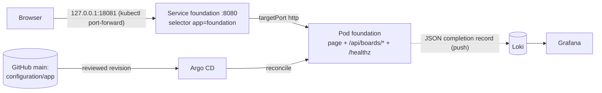

# Basic GitOps using Argo CD and Minikube

[](https://github.com/islandawolfe-02/Basic-GitOps-using-Argo-CD-and-Minikube/actions/workflows/p1-gates.yml)

Project 1 (BP Software Engineering Academy, Week 1): a reproducible GitOps deployment of the supplied treasure-hunt
**foundation**, a single ASP.NET Core image that serves a browser page and a board API on the same origin. The
deployment runs on a local minikube cluster. Argo CD reconciles a reviewed Git revision of `configuration/app`, and
request records go to Loki and Grafana. The project also includes one deliberate configuration failure, with its
diagnosis and recovery.

> **Scope.** Executed on a personal minikube cluster (MacBook Air M2), as the facilitator-approved replacement for the
> classroom Kubernetes/Argo CD environment. This is **not** a BP Yalla scaffold, BP pull request or BP deployment:
> those remain **pending** because the approved walkthrough was not supplied.

Status key: *executed on minikube (date)* / *historical (lab, date)* / *pending* / *unavailable on BP*.

## Architecture



The page calls the **relative** path `/api/boards/reference`, so the request returns through the same Service and
port as the page. No cluster-internal hostname or CORS is involved. The port-forward tests the path
Mac → API server → Service → selected Pod. It is not a public ingress.

| Route | Expected |
|---|---|
| `GET /` | foundation page "Treasure hunt board preview" |
| `GET /api/boards/reference` | `200`, 3 × 3 board, 6 initial moves, headers `X-Lab-Release: foundation-observe-a`, `X-Lab-Environment`, echoed `X-Request-Id` |
| `GET /api/boards/missing` | `404 {"code":"NOT_FOUND","message":"Board not found"}` |
| `GET /healthz` | `200 Healthy` (narrow liveness only) |

## Repository layout

| Path | Owner | Purpose |
|---|---|---|
| `app/` | supplied (unchanged except `wwwroot/client.json`) | foundation source, release `foundation-observe-a` |
| `app/wwwroot/client.json` | owned | browser deadline/retries |
| `runtime.env` | owned | public `LAB_ENV` for the local container |
| `Containerfile` | owned | multi-stage, digest-pinned packaging recipe |
| `configuration/app/resources.yaml` | owned | desired state: ConfigMap, Deployment, Service (Argo CD source path) |
| `argocd/application.yaml` | environment | Argo CD Application template |
| `observability/` | environment | Loki 3.7.8 + Grafana 13.2.3 (W1.10 datasource and dashboard) |
| `scripts/` | environment | `p1.env` session variables, `smoke.sh`, `check-config.sh`, `setup-cluster.sh` |
| `.github/workflows/p1-gates.yml` | environment | CI gates (build + smoke, configuration); never deploys |
| `evidence/`, `evidence-log.md` | owned | real outputs per milestone |

## Starting files and source version
* Supplied application copied unchanged from the course `projects/code/app` (release `foundation-observe-a`).
  Source commit in this repository: `____`
* Packaging change against the classroom guided recipe: the host `dotnet publish` + `COPY publish/` became a build stage
  inside `mcr.microsoft.com/dotnet/sdk:10.0.401` (pinned by digest). The runtime base is unchanged
  (`aspnet:10.0.12@sha256:222759b3…`), and so are the listener on 8080 and the entrypoint. Reason: the MacBook and CI need no local .NET SDK.

## Prerequisites
macOS on Apple silicon, Docker (Docker Desktop or compatible), minikube, kubectl, Argo CD CLI, yq v4, Git
(`brew install kubectl argocd yq git`). Recorded versions: Docker `____`, minikube `____`, kubectl `____`,
argocd `____`. Cluster components are pinned: Argo CD v3.5.2 (core install), Loki 3.7.8, Grafana 13.2.3.
Session variables (public values, no credentials) are in [`scripts/p1.env`](scripts/p1.env): `P1_NAMESPACE`,
`P1_SESSION`, `P1_IMAGE`, `P1_LOCAL_LOKI_URL`, `P1_CLUSTER_LOKI_URL`, `P1_GRAFANA_URL`.

## Quick start (fresh clone)
```bash
git clone https://github.com/islandawolfe-02/Basic-GitOps-using-Argo-CD-and-Minikube.git
cd Basic-GitOps-using-Argo-CD-and-Minikube
source scripts/p1.env
bash scripts/setup-cluster.sh                       # minikube, Argo CD, Loki/Grafana, namespace, Application

# Build and check locally (packaging gate)
docker build -f Containerfile -t "$P1_IMAGE" .
docker image inspect "$P1_IMAGE" --format '{{.Id}}'
docker run -d --name "$P1_NAMESPACE-local" -p 127.0.0.1:18080:8080 --env-file runtime.env \
  -e LAB_SESSION="$P1_SESSION" -e LOCAL_LOKI_URL="$P1_LOCAL_LOKI_URL" "$P1_IMAGE"
bash scripts/smoke.sh http://127.0.0.1:18080 "$(sed -n 's/^LAB_ENV=//p' runtime.env)"

# Import the checked image into the cluster (the classroom facilitator's import), then deploy the reviewed revision
minikube image load "$P1_IMAGE"
minikube ssh -- docker image inspect "$P1_IMAGE" --format '{{.Id}}'     # runtime image identity
export P1_REVISION=$(git rev-parse origin/main)
argocd --core app sync "$P1_NAMESPACE" --revision "$P1_REVISION"
argocd --core app wait "$P1_NAMESPACE" --sync --health --timeout 90
kubectl -n "$P1_NAMESPACE" get deployment,pods,service,endpointslices
kubectl -n "$P1_NAMESPACE" port-forward service/foundation 18081:8080   # keep running
bash scripts/smoke.sh http://127.0.0.1:18081 "$(sed -n 's/^LAB_ENV=//p' runtime.env)"   # second terminal
```
A peer's rebuilt image normally has a **different** image ID. Compare source commit and configuration, and deploy only
the image that was reviewed.

## Build and image identity
| Item | Value |
|---|---|
| Image label | `localhost/p1-islandawolfe-02:foundation-a` |
| Local image ID (Mac, `docker image inspect`) | `____` |
| Runtime image ID in minikube (`minikube ssh -- docker image inspect`) | `____` |
| Pod `status.containerStatuses[0].imageID` | `____` |
| CI image ID (amd64 gate build, **not deployed**) | see the p1-gates run summary |

## Public configuration
* `LAB_ENV`: `____` (`runtime.env` and the ConfigMap agree; `check-config.sh` enforces it)
* `client.json`: `{"deadlineMs":450,"retries":0}`. Justification (historical, W1.10, 2026-11-02): the slowest fixture the
  browser must receive (Slow) needed about 302 ms of server processing. A retry starts a new request that restarts that
  work, so retries cannot help. Only the per-attempt deadline matters. 400/0 received Slow in 315 ms, and 200/2 failed
  all three attempts. 450/0 keeps a margin above about 300 ms within the 650 ms budget, and Overdue (900 ms) stays a
  bounded *unavailable* outcome at about 450 ms.
* Service: selector `app: foundation` must match the Pod-template label. `port: 8080` → `targetPort: http`, which is
  the named container port 8080. `imagePullPolicy: Never` because the image is imported into the node with
  `minikube image load`. This is not a registry policy. The probes check `/healthz`, which shows the process answers,
  not that the board response is right.

## Deployment revision and review
| Step | Revision (full) | PR | Self-review decision | Argo sync / health |
|---|---|---|---|---|
| Initial deploy | `____` | #__ | ____ | ____ |
| Failure: selector `foundation-missing` | `____` | #__ | ____ | ____ |
| Recovery: selector restored | `____` | #__ | ____ | ____ |
| Environment blue → green | `____` | #__ | ____ | ____ |

Review happens on the GitHub pull request. CI (`p1-gates`) is a check, not the approver. A merged PR only publishes the
revision. The deployment happens when `argocd --core app sync --revision <full sha>` reconciles it.

## Startup and verification
| Check | Command | Expected | Actual (time UTC, request ID) |
|---|---|---|---|
| Health | `curl http://127.0.0.1:18081/healthz` | 200 Healthy | |
| Reference (browser) | open `http://127.0.0.1:18081`, Reference, Load board | 200, 3×3, 6 moves, `foundation-observe-a`, env | |
| Reference (API) | `bash scripts/smoke.sh http://127.0.0.1:18081 <env>` | RESULT: PASS | |
| Missing | `/api/boards/missing` | 404 NOT_FOUND | |
| Endpoint | `kubectl -n p1-islandawolfe-02 get endpointslices` | ready endpoint → the foundation Pod | |
| Grafana | `{job="academy-w110", session="p1-islandawolfe-02-mac"} \| json \| request_id="…"` | one matching row | |

## Controlled failure and recovery
* **Failure:** the Service selector changed `app: foundation` → `app: foundation-missing`. Prediction: ____.
  Observed: the Pod stayed Running/Ready, the EndpointSlice had no endpoints, and a fresh port-forward failed with ____.
  Rebuilding the image would not help: the image was never the fault. The Service's label query matched no Pod.
* **Recovery:** corrective revision `____`. The fresh port-forward and smoke check gave ____, and the matching Grafana row was ____.
* **Environment change (blue → green):** ConfigMap `LAB_ENV` and `academy/config-revision` were bumped in the same
  commit `____`. A fresh request returned `X-Lab-Environment: ____`. A ConfigMap edit alone does not change a running
  process, because environment variables are read once at container start. The annotation changes the Pod template, so
  the Deployment rolls out a new Pod.

## Recovery procedure
Restore the last reviewed configuration revision, either by `git revert <bad sha>` in a new PR or by a corrective PR.
Merge it and sync the new full SHA with `argocd --core app sync … --revision`. Then wait for Synced/Healthy, start a
**fresh** port-forward and repeat the verification table with a new request ID.

## Stop and clean up
`docker stop p1-islandawolfe-02-local`, stop port-forwards with Ctrl-C, and `minikube stop` (or `minikube delete` to
remove everything). Never commit `publish/`, kubeconfig or credentials.

## BP items still pending
Yalla scaffolding, the BP pull request, the BP registry and image promotion, and the BP deployment and status/log
views are all *unavailable on BP*, because the approved walkthrough was not supplied. The W1.09 plan carries them
forward.
