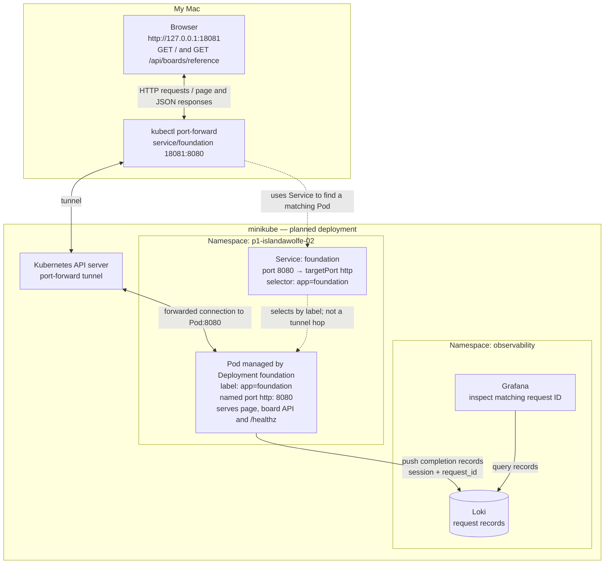

# Project 1 evidence log

Route: personal minikube on a MacBook Air M2, with GitHub PRs and Argo CD v3.5.2 core (facilitator-approved
replacement for the classroom environment). Operator / predictor: islandawolfe-02 for both (solo, self-reviewed).

## 1. Plan and baseline (write before Milestone 2)
* Game intention: each turn, the player moves one square up, down, left
  or right. The game tracks the player's position, remaining moves (starting at 6), collected treasures and score
  (the treasure is worth 10). The player wins by reaching the exit square and loses if moves run out before reaching
  the exit. A wall blocks the player; a blocked move does not use up a move.
* Destination: namespace `p1-islandawolfe-02`, Argo CD Application `p1-islandawolfe-02`, minikube context `minikube`
* Reviewer: islandawolfe-02 (self-review on GitHub PRs)
* Historical baseline (W1.10, 2026-11-02, local WSL, emulated client): Reference 200 in 7–9 ms, Missing 404, Slow
  about 302 ms of server time (400/0 received it, 200/2 did not), Overdue 902 ms (unavailable), workshop-blue.
* Fresh smoke expectations: the page loads; Reference gives HTTP 200 and the exact `app/data/board-reference.json` (3×3, 6 moves);
  `/healthz` gives Healthy; the release is `foundation-observe-a`; the environment is my `LAB_ENV`; Missing gives a separate 404 NOT_FOUND.

### Planned request path

Solid lines show the request/response tunnel and the separate logging path. Dotted lines show Pod selection.

The page and the API come from the same Pod, through the same address. The logs do not go back to the browser;
they go to Loki on their own path. With `kubectl port-forward service/foundation`, the Service's selector is used
to choose a Pod, and the tunnel goes through the API server to that Pod. The Pod's actual name will be recorded
when deployed; `foundation` is the Deployment and Service name.

### Why the browser does not need the cluster-internal name

The page asks for `/api/boards/reference`, which has no hostname, just a path. The browser then sends that request
to the same place the page came from, which is `127.0.0.1:18081`. That address already leads to the selected Pod
through the port-forward, so the API call takes the same route as the page.

The `foundation.p1-islandawolfe-02.svc.cluster.local` name is for DNS inside the cluster; my Mac's browser does not
normally resolve it. So the browser never needs the internal name. It is the same idea as W1.06: the browser used
`/api/...`, and only the frontend container used the internal name `api`.

Milestone 1 plan recorded on 2026-11-13 from the learner's answers, with AI assistance for formatting and
port-forward terminology. The request path above is planned; no fresh deployment results are claimed here.

## Milestone log
| Time (UTC) | Milestone | Observation (command, result, identifiers) | Evidence file |
|---|---|---|---|
| | 2 local image ID / smoke / Grafana row | | evidence/m2-local/ |
| | 3 review decision (PR #, full commit) | | PR link |
| | 4 Argo revision / Pod image ID / endpoint / response / Grafana row | | evidence/m4-deploy/ |
| | 5 failure: prediction, empty endpoints, failed port-forward, healthy Pod | | evidence/m5-failure/ |
| | 5 recovery: corrective revision, fresh request | | evidence/m5-recovery/ |
| | 5 blue → green: annotation bump, header | | evidence/m5-green/ |
| | 6 fresh-clone reproduction: image ID, comparison | | evidence/m6-reproduce/ |

Individual reflection: assistance used ____; one rejected repair and why ____; one next learning step ____.
