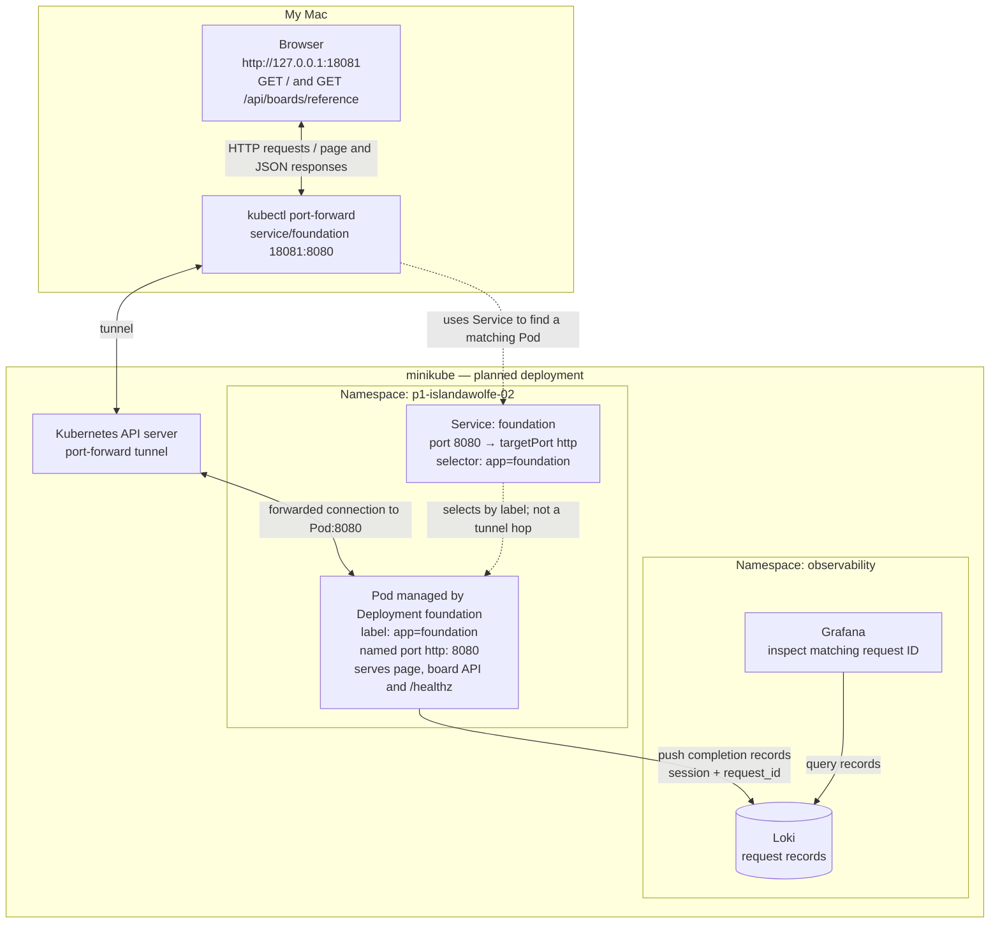

# Project 1 evidence log

Route: personal minikube on a MacBook Air M2, with GitHub PRs and Argo CD v3.5.2 core (facilitator-approved
replacement for the classroom environment). Operator / predictor: islandawolfe-02 for both (solo, self-reviewed).

## 1. Plan and baseline (write before Milestone 2)
* Game intention: each turn, the player moves one square up, down, left
  or right. The game tracks the player's position, remaining moves (starting at 6), collected treasures and score
  (the treasure is worth 10). The player wins by reaching the exit square and loses if moves run out before reaching
  the exit. A wall blocks the player; a blocked move does not use up a move.
* Destination: namespace `p1-islandawolfe-02`, Argo CD Application `p1-islandawolfe-02`, minikube context `minikube`
* Reviewer: islandawolfe-02 (self-review on GitHub PRs)
* Historical baseline (W1.10, 2026-11-02, local WSL, emulated client): Reference 200 in 7–9 ms, Missing 404, Slow
  about 302 ms of server time (400/0 received it, 200/2 did not), Overdue 902 ms (unavailable), workshop-blue.
* Fresh smoke expectations: the page loads; Reference gives HTTP 200 and the exact `app/data/board-reference.json` (3×3, 6 moves);
  `/healthz` gives Healthy; the release is `foundation-observe-a`; the environment is my `LAB_ENV`; Missing gives a separate 404 NOT_FOUND.

### Planned request path

Solid lines show the request/response tunnel and the separate logging path. Dotted lines show Pod selection.

The page and the API come from the same Pod, through the same address. The logs do not go back to the browser;
they go to Loki on their own path. With `kubectl port-forward service/foundation`, the Service's selector is used
to choose a Pod, and the tunnel goes through the API server to that Pod. The Pod's actual name will be recorded
when deployed; `foundation` is the Deployment and Service name.

### Why the browser does not need the cluster-internal name

The page asks for `/api/boards/reference`, which has no hostname, just a path. The browser then sends that request
to the same place the page came from, which is `127.0.0.1:18081`. That address already leads to the selected Pod
through the port-forward, so the API call takes the same route as the page.

The `foundation.p1-islandawolfe-02.svc.cluster.local` name is for DNS inside the cluster; my Mac's browser does not
normally resolve it. So the browser never needs the internal name. It is the same idea as W1.06: the browser used
`/api/...`, and only the frontend container used the internal name `api`.

Milestone 1 plan recorded on 2026-11-13 from the learner's answers, with AI assistance for formatting and
port-forward terminology. The request path above is planned; no fresh deployment results are claimed here.

## 2. Package and run locally

Executed locally with Docker on the personal Mac on 2026-11-13. Loki and Grafana ran on personal minikube;
at this milestone, the foundation application had not yet been deployed to minikube.

* Source commit: `5153f37a19a7e9326f2532817100eecc00eb29b6` (`evidence/m2-local/source-commit.txt`).
* Image: `localhost/p1-islandawolfe-02:foundation-a`.
* Mac image ID: `sha256:e563cb59f857747b351e1a10664086a2a49b2645a1b0b3c45d06ae82d83b4947`.
  The ID in `build.log` matches `image-id.txt`; this is the local image, not a CI rebuild.
* Local access: `http://127.0.0.1:18080`, using published port `127.0.0.1:18080` → container port `8080`.
* Settings: `LAB_ENV=workshop-blue`, `deadlineMs=450`, `retries=0`; budget `450 × (0 + 1) = 450 ms`.
  Reason (AI-assisted): blue is the starting environment so Milestone 5 can show the change to green. The historical
  Slow response took about 302 ms, so a 450 ms deadline gives it some margin. Retries restart the work rather than
  extend the original attempt, so zero retries keeps the total budget at 450 ms, below the 650 ms limit. The
  historical Overdue response took about 900 ms and is expected to time out with these settings.
* Smoke check: `bash scripts/smoke.sh http://127.0.0.1:18080 workshop-blue evidence/m2-local` returned
  `RESULT: PASS`. Health, page, app.js, exact reference body, release/environment headers, request-ID echo and
  missing-board 404 all passed (`smoke.txt`).
* Browser: Reference returned 200, release `foundation-observe-a`, environment `workshop-blue`, in 11 ms
  (`browser-observation.json`). Request ID: `3eb04f34-04e4-46f2-87d1-96cce6f58569`.
* Logs: the matching completion record is timestamped `2026-11-13T11:45:51.4651105Z`; status 200, server duration
  2 ms. No `LOKI_DELIVERY_WARNING` appears in the saved `local-logs.txt`.
* Grafana: `grafana.png` shows the same request ID, session `p1-islandawolfe-02-mac`, status 200, release and
  environment in the **P1 Foundation requests** dashboard. Its title was renamed from **W1.10 requests**;
  the dashboard UID and application log label remain unchanged.

AI assistance: explained the settings, checked the saved evidence, helped diagnose Grafana access and time-range
messages, and drafted the settings explanation.

## 3. Review the deployment proposal

Image import executed on personal minikube; proposal merged on 2026-11-14.

* PR: [#3](https://github.com/islandawolfe-02/Basic-GitOps-using-Argo-CD-and-Minikube/pull/3), branch `m3-initial-deploy`.
* Merged revision: `8ae88b2f112824f7aef4dc3d0ef51eeb941335b2`, merged at `2026-11-14T13:43:41Z`.
* Replaced the image, `LAB_SESSION` and `LOCAL_LOKI_URL` placeholders in `configuration/app/resources.yaml`.
  `academy/config-revision` is `"2"`; `LAB_ENV` remains `workshop-blue`.
* Imported image ID: `sha256:e563cb59f857747b351e1a10664086a2a49b2645a1b0b3c45d06ae82d83b4947`.
  The saved minikube ID matches the Mac ID from Milestone 2, ignoring the SSH carriage return
  (`evidence/m2-local/minikube-image-id.txt` and `evidence/m2-local/image-id.txt`).
* Local configuration check: `RESULT: PASS` (`evidence/m4-deploy/config-check.txt`).
* CI: Package gate and Configuration gate both passed in
  [p1-gates run 43601163480](https://github.com/islandawolfe-02/Basic-GitOps-using-Argo-CD-and-Minikube/actions/runs/43601163480).
  The CI image is a separate amd64 build and was not deployed.
* Self-review decision: ____ (no separate decision comment found on PR #3; the required pre-merge record is missing).

## 4. Deploy through Argo CD

Executed on personal minikube on 2026-11-14.

* Reviewed revision: `8ae88b2f112824f7aef4dc3d0ef51eeb941335b2` (`deployed-revision.txt`).
* `argocd --core app sync p1-islandawolfe-02 --revision <reviewed revision>` succeeded at
  `2026-11-14T13:49:33Z`. Argo reports **Synced / Healthy** at that same revision
  (`sync.txt`, `argo-app.txt`, `argo-application.json`).
* Pod: `foundation-7d5c485f7d-bdp6l`, Running and Ready (`resources.txt`, `running-pods.json`).
* Pod image ID: `docker://sha256:e563cb59f857747b351e1a10664086a2a49b2645a1b0b3c45d06ae82d83b4947`.
  The SHA matches the Milestone 2 Mac image; `docker://` is the runtime prefix
  (`pod-image-id.txt`, `identity-check.txt`).
* Pod IP: `10.244.0.95`. EndpointSlice `foundation-s5c8v` has the same ready endpoint IP
  (`resources.txt`, `endpointslices.json`).
* Access: `kubectl -n p1-islandawolfe-02 port-forward service/foundation 18081:8080`.
  The browser uses `http://127.0.0.1:18081` (`port-forward.txt`).
* Smoke check: `bash scripts/smoke.sh http://127.0.0.1:18081 workshop-blue evidence/m4-deploy` returned
  `RESULT: PASS`. Health, page, app.js, exact reference body, release/environment headers, request-ID echo and
  missing-board 404 all passed (`smoke.txt`).
* Browser: Reference returned 200, release `foundation-observe-a`, environment `workshop-blue`.
  The action took 103 ms; its one attempt took 99 ms (`browser-observation.json`).
* Browser request ID: `71365f70-a24a-4872-89be-5935c0e88ed8`.
* Matching Pod log: `2026-11-14T14:05:10.5802682Z`, path `/api/boards/reference`, status 200,
  server duration 2 ms. No `LOKI_DELIVERY_WARNING` appears in the saved logs (`pod-logs.txt`).
* Grafana: `grafana.png` shows the same request ID, timestamp, session `p1-islandawolfe-02-mac`, status 200,
  release and environment in the **P1 Foundation requests** dashboard.

The Argo revision matches the reviewed revision; the Pod image SHA matches the Mac image; the ready endpoint
matches the Pod IP; and the body, release and environment checks pass. The port-forward tunnels requests from
the Mac through the Kubernetes API server to a Pod selected using the foundation Service. It is not an ingress.

All filenames in this section are under `evidence/m4-deploy/`. These are personal minikube results; BP deployment
remains pending.

AI assistance: ran the Argo sync, smoke and identity checks, checked the saved evidence, and updated this log.
The learner saved the final browser observation, Pod logs and Grafana screenshot.

## 5.1 Selector failure

Status: pending deployment and observation on personal minikube.

Prediction (before sync):

* Changing the Service selector to `app: foundation-missing` should leave the foundation Pod Running and Ready,
  because the Deployment and health probes are unchanged.
* The Service should have no ready endpoints because its selector matches no Pod.
* A new `kubectl port-forward service/foundation 18081:8080` should fail or time out because it cannot find a
  matching Pod. The old port-forward must be stopped first; an existing tunnel may still reach its selected Pod.
* Rebuilding the image would not fix this failure. Restoring the Service selector to `app: foundation` should
  allow it to find the Pod again.

Observed after sync: pending. Record the actual Pod state, endpoints and new port-forward result here.

Evidence: `evidence/m5-failure/`.

## Milestone log
| Time (UTC) | Milestone | Observation (command, result, identifiers) | Evidence file |
|---|---|---|---|
| 2026-11-13 11:45:51 (browser request) | 2 local image ID / smoke / Grafana row | Local build and smoke PASS; browser request `3eb04f34-04e4-46f2-87d1-96cce6f58569` matches logs and Grafana screenshot. Full source/image IDs and settings explanation above. | [evidence/m2-local/](evidence/m2-local/) |
| 2026-11-14 13:43:41 (merge) | 3 deployment proposal | PR #3 merged as `8ae88b2f112824f7aef4dc3d0ef51eeb941335b2`; image IDs match and both CI gates passed. Separate self-review decision missing. See section 3. | [PR #3](https://github.com/islandawolfe-02/Basic-GitOps-using-Argo-CD-and-Minikube/pull/3) |
| 2026-11-14 14:05:10 (browser request) | 4 deployment verification | Argo Synced/Healthy; image SHA and endpoint match; smoke PASS; request `71365f70-a24a-4872-89be-5935c0e88ed8` matches browser, Pod logs and Grafana. See section 4. | [evidence/m4-deploy/](evidence/m4-deploy/) |
| | 5 failure: prediction, empty endpoints, failed port-forward, healthy Pod | Prediction recorded in section 5.1; deployment and observations pending. | evidence/m5-failure/ |
| | 5 recovery: corrective revision, fresh request | | evidence/m5-recovery/ |
| | 5 blue → green: annotation bump, header | | evidence/m5-green/ |
| | 6 fresh-clone reproduction: image ID, comparison | | evidence/m6-reproduce/ |

Individual reflection: assistance used ____; one rejected repair and why ____; one next learning step ____.
